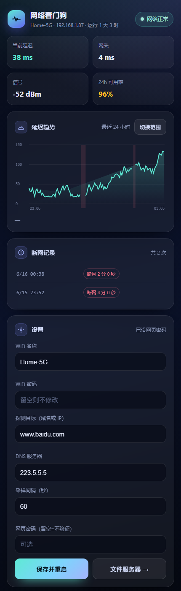

# WatchDog · 家庭网络看门狗 + 迷你文件服务器

一块 ESP8266（WeMos D1 / NodeMCU，4MB Flash）就能跑起来的网络体检工具：
定时探测网络、记录断网时间和延迟曲线，同时自带一个网页文件服务器。

全程只用板子本身，不需要任何额外元件。



---

## 功能

| 模块 | 说明 |
| --- | --- |
| 网络探测 | 每 60 秒（可改）一次 DNS 查询 + TCP 连接探测，记录延迟 |
| 断网判定 | 连续 2 次失败才判定离线，避免偶发丢包误报 |
| 分层判定 | 网关也不通=局域网断，网关通=外网断，推送文案分开 |
| 延迟统计 | 实时 / p50 / p95 / 最大值 / 抖动（相邻采样差均值），页面直接给 |
| 历史曲线 | 保留 720 个采样点（默认 12 小时），掉电前落盘 `/hist.bin`，可导出 CSV |
| 断网记录 | 每次断网时长 + 信号，落盘 `/outages.bin`，**重启不丢**（40 条环形） |
| 看板 | 实时状态、延迟折线、可用率、断网时间线、信号强度 |
| 设备健康 | 复位原因、堆碎片、WiFi 掉线次数、关联尝试、上次探测；heap < 6KB 持续 5 分钟自动重启 |
| 文件服务器 | 上传 / 下载 / 删除，存设备 Flash（约 1MB 可用） |
| 配网 | 首次启动自动开 `WatchDog-Setup` 热点，网页填 WiFi 即用 |
| 主备 WiFi | 可填第二组 WiFi，主 SSID 连不上时自动切换 |
| 每日简报 | 每天 08:00 推一条 Server 酱日报（可用率 / 断网次数 / p95 / 信号） |
| 指示灯 | 常亮=正常；双闪=断网；快闪=WiFi 掉线；慢闪=配网模式 |
| OTA | 网页上传新固件即可升级，不用插线 |

## 快速使用

**第一次**

1. 插电，手机连热点 `WatchDog-Setup`（开放）
2. 浏览器打开 `192.168.4.1`
3. 扫描或手填家里 WiFi 名称 / 密码，建议再设一个「网页密码」
4. 保存 → 设备重启 → 连回家里的 WiFi

**日常**

- 浏览器访问设备 IP，或 `http://watchdog.local`
- 看板每 5 秒刷新；断网会显示成红色区段，下面列出每次断网的时长
- 「文件服务器」页面上传/下载文件，重启不丢

> 查找设备 IP：路由器后台的设备列表里找 `watchdog`，或安卓用 `watchdog.local`。

## 烧录

```powershell
cd 工具
.\flash.ps1 -Port COMx
```

> Windows PowerShell 默认禁止跑脚本，用 `powershell -ExecutionPolicy Bypass -File .\flash.ps1 -Port COMx` 即可。

## 自己编译

1. Arduino IDE 装 ESP8266 core **3.0.2**，开发板 `Generic ESP8266 Module`
2. Flash Size **4MB (FS:1MB OTA:~1019KB)**，Flash Mode `DOUT`，CPU `80MHz`
3. 编译导出 bin → 用 `flash.ps1 -Bin` 指定

## HTTP 接口

| 路径 | 说明 |
| --- | --- |
| `GET /` | 看板 |
| `GET /files` | 文件服务器 |
| `GET /api/status` | 当前状态 JSON |
| `GET /api/health` | 健康与复位原因 |
| `GET /api/outages` | 断网记录 |
| `GET /api/clear?what=outages\|hist\|all` | 清空记录 |
| `GET /api/history` | 历史采样 CSV |
| `GET /api/config` | 读取配置 |
| `POST /api/config` | 保存配置 |
| `GET /api/scan` | 扫描周边 WiFi |
| `GET /api/files` | 文件列表 |
| `POST /api/upload` | 上传 |
| `GET /dl?n=文件名` | 下载 |
| `GET /api/delete?n=文件名` | 删除 |
| `POST /api/ota` | 固件升级 |
| `GET /api/reboot` | 重启 |

详细说明见 `docs/` 目录。

## 免责声明

仅用于自有网络的质量监测与学习。请勿用于探测、干扰他人网络。
