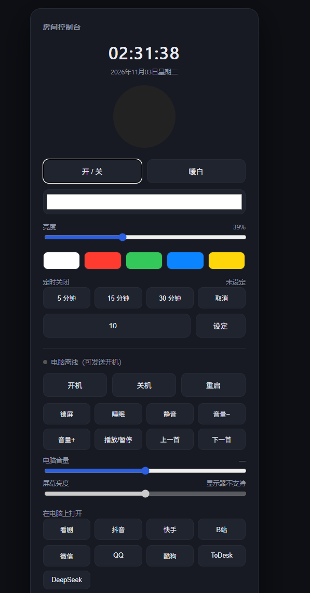

# WatchDog · 家庭网络看门狗 + 迷你文件服务器

一块 ESP8266（WeMos D1 / NodeMCU，4MB Flash）就能跑起来的网络体检工具：
定时探测网络、记录断网时间和延迟曲线，同时自带一个网页文件服务器。

全程只用板子本身，不需要任何额外元件。




---

## 功能

| 模块 | 说明 |
| --- | --- |
| 网络探测 | 每 60 秒（可改）一次 DNS 查询 + TCP 连接探测，记录延迟 |
| 断网判定 | 连续 2 次失败才判定离线，避免偶发丢包误报 |
| 分层判定 | 网关也不通=局域网断，网关通=外网断，推送文案分开 |
| 延迟统计 | 实时 / p50 / p95 / 最大值 / 抖动（相邻采样差均值），页面直接给 |
| 历史曲线 | 保留 720 个采样点（默认 12 小时），掉电前落盘 `/hist.bin`，可导出 CSV |
| 断网记录 | 每次断网时长 + 信号，落盘 `/outages.bin`，**重启不丢**（40 条环形） |
| 看板 | 实时状态、延迟折线、可用率、断网时间线、信号强度 |
| 设备健康 | 复位原因、堆碎片、WiFi 掉线次数、关联尝试、上次探测；heap < 6KB 持续 5 分钟自动重启 |
| 文件服务器 | 上传 / 下载 / 删除，存设备 Flash（约 1MB 可用） |
| 配网 | 首次启动自动开 `WatchDog-Setup` 热点，网页填 WiFi 即用 |
| 主备 WiFi | 可填第二组 WiFi，主 SSID 连不上时自动切换 |
| 每日简报 | 每天 08:00 推一条 Server 酱日报（可用率 / 断网次数 / p95 / 信号） |
| 指示灯 | 常亮=正常；双闪=断网；快闪=WiFi 掉线；慢闪=配网模式 |
| OTA | 网页上传新固件即可升级，不用插线 |

## 快速使用

**第一次**

1. 插电，手机连热点 `WatchDog-Setup`（开放）
2. 浏览器打开 `192.168.4.1`
3. 扫描或手填家里 WiFi 名称 / 密码，建议再设一个「网页密码」
4. 保存 → 设备重启 → 连回家里的 WiFi

**日常**

- 浏览器访问设备 IP，或 `http://watchdog.local`
- 看板每 5 秒刷新；断网会显示成红色区段，下面列出每次断网的时长
- 「文件服务器」页面上传/下载文件，重启不丢

> 查找设备 IP：路由器后台的设备列表里找 `watchdog`，或安卓用 `watchdog.local`。

## 目录结构

```
esp8266-watchdog/
├─ WatchDog\
│  ├─ WatchDog.ino          固件源码（单文件，无第三方库）
│  └─ data\                 网页（上传到文件系统）
│     ├─ config.txt         配置文件模板（WiFi / 固定IP / SendKey 等）
│     ├─ index.html         看板
│     ├─ files.html         文件服务器
│     ├─ setup.html         首次配网
│     └─ ui.css / ui.js     共用样式与工具
├─ 工具\
│  ├─ flash.ps1             一键烧录
│  └─ 打开看板.ps1           查找设备 IP 并打开看板
└─ docs\
   ├─ dashboard.png         看板截图
   ├─ console_app.png       手机控制台截图
   ├─ build-and-flash.md    构建 / 烧录 / 排障手册
   ├─ roadmap.md            功能规划
   └─ optimization.md       优化建议清单
```

> **固件/ 目录不在仓库里**：`WatchDog.bin`、`filesystem.bin` 等编译产物包含烧录时的
> 个人 WiFi 凭据与推送密钥，不应提交。请按「自己编译 + 烧录」自行生成。

## 烧录

```powershell
cd 工具
.\flash.ps1 -Port COMx
```

| 区块 | 地址 | 大小 |
| --- | --- | --- |
| 固件 | `0x0` | 约 499 KB（v1.3.2） |
| 文件系统（LittleFS） | `0x300000` | `0xFA000`（1,024,000 B） |
| 其它 | `0x3FC000` | RF 校准，不动 |

> Windows PowerShell 默认禁止跑脚本，直接双击/`.\flash.ps1` 会报“禁止运行脚本”，
> 用 `powershell -ExecutionPolicy Bypass -File .\flash.ps1 -Port COMx` 即可。

只用改网页时：

```powershell
.\flash.ps1 -FsOnly
```

## 自己编译

Arduino IDE：

1. 开发板管理器装 ESP8266 core **3.0.2**
2. 打开 `WatchDog/WatchDog.ino`
3. 开发板 `Generic ESP8266 Module`
4. Flash Size **4MB (FS:1MB OTA:~1019KB)**
5. Flash Mode `DOUT`，CPU `80MHz`
6. 编译导出 bin → 用 `flash.ps1 -Bin` 指定

命令行（arduino-cli）：

```powershell
arduino-cli compile --fqbn esp8266:esp8266:generic:eesz=4M1M --output-dir out WatchDog
```

编译完成后，把 `WatchDog.ino.bin` 改名为 `WatchDog.bin` 放入 `固件\` 目录
（或在烧录时用 `-Bin` 直接指定），再执行 `flash.ps1`。

资源占用（v1.3.x）：Flash 约 507 KB / 1044 KB（48%），RAM 约 41 KB / 82 KB（50%），运行 heap 约 33 KB。

## HTTP 接口

| 路径 | 说明 |
| --- | --- |
| `GET /` | 看板 |
| `GET /files` | 文件服务器 |
| `GET /setup` | 配网页 |
| `GET /api/status` | 当前状态 JSON（含 p50/p95/max/jitter/drops/err） |
| `GET /api/health` | 健康与复位原因（reason/exccause/heap/frag/drops/tries/ap_idx） |
| `GET /api/outages` | 断网记录（已落盘，最多 40 条） |
| `GET /api/clear?what=outages\|hist\|all` | 清空断网记录 / 历史曲线 / 全部（连文件一起删，重启不会回来） |
| `GET /api/history` | 历史采样 CSV：`时间戳,延迟,是否在线`（看板“导出 CSV”就走的这个） |
| `GET /api/config` | 读取配置（含 ssid2 / daily） |
| `POST /api/config` | 保存配置（ssid/pass/ssid2/pass2/host/dns/ip/gw/mask/interval/webpass/sendkey/daily），保存后重启 |
| `GET /api/scan` | 扫描周边 WiFi |
| `GET /api/files` | 文件列表 + 空间占用 |
| `POST /api/upload` | 上传（multipart，字段名 `f`） |
| `GET /dl?n=文件名` | 下载 |
| `GET /api/delete?n=文件名` | 删除 |
| `POST /api/ota` | 上传固件升级 |
| `GET /api/reboot` | 重启 |

> **默认未启用网页密码**（`webpass` 为空）：打开就是看板，不弹登录框。
> 若要启用：设置页「网页密码」填值保存，用户名固定 `admin`，密码就是填的那个。
> ⚠ Basic 认证是明文，而且**安卓 Chrome 在没凭据时不会弹框**，直接报 `ERR_HTTP_RESPONSE_CODE_FAILURE`，
> 手机端体验很差——想要访问控制，建议做页内登录而不是 Basic。
> 取消：设置页勾「清除网页密码」保存并重启（v1.3.1 起）。

## 网页打不开？按这个顺序查（v1.1.0 之后）

| 步骤 | 做法 | 判据 |
| --- | --- | --- |
| 1 | 先看页面「设备健康」卡（或 `GET /api/health`） | 复位原因是不是「异常复位」、掉线次数是不是在涨、last_err 是 1 还是 2 |
| 2 | 确认设备 IP：`http://watchdog.local`，或按 MAC（设备标签上）查 `arp -a` | DHCP 会换地址，别死守旧 IP |
| 3 | 数字节：`curl -s -o NUL -w "%{size_download}" http://<ip>/` | 必须等于 `data/index.html` 的大小（v1.3.1 是 17,351 B）；几百/几千 = 传输被截断 |
| 4 | 空闲 45 秒再请求首页 | 应 1~3 秒返回完整页面（弱信号会慢，但不应截断） |
| 5 | 手机报 `ERR_HTTP_RESPONSE_CODE_FAILURE` | 不是网络问题：服务器回了 401（网页密码开着且手机没凭据），手机端清一下站点数据，或直接关掉网页密码 |
| 6 | 串口抓 boot 日志（115200） | 出现 `[sta] connected ... ip=x.x.x.x` 才算连上；只有 `[setup] AP` 说明退回配网模式 |

v1.1.0 针对“一直转圈/白屏”修了三处（细节见 `docs/build-and-flash.md`）：

- 关掉 WiFi 省电（`WIFI_NONE_SLEEP`）：空闲后第一个请求不再卡 5~40 秒；
- 页面改成 512 B 分块 + 短写重发 + 关闭前排空发送队列：不再出现只发一半的页面；
- 开机先扫描再按 BSSID/信道直连，45 秒预算内自动重试：弱信号下也能连上，连不上会每分钟自愈重试。

## 已知边界

- **RAM 只有 80KB、可用堆约 34KB**：历史固定 720 点，别改太大；单文件上传建议 < 300KB
- **断网判定**：DNS 探测失败会退回 TCP 探测；两者都失败才算一次失败
- **时间**：断网时 NTP 不能对时，断网记录的时间戳会回退成“启动后秒数”
- **写盘**：`/hist.bin` 每 10 个采样点写一次（掉电最多丢 10 点）；`/outages.bin` 只在断网开始和结束各写一次
- 设备本身不联网也可用（文件服务器、看板照常，只是没有外网数据）
- **留空 = 不修改**：WiFi 密码、备用密码、网页密码、SendKey 都是这个语义（网页不回显密码，提交空串不能当成清空）。
  真要清空，勾网页上的「清除网页密码 / 关闭断网推送」。
- **固定 IP**：`config.txt` 里 `ip/gw/mask` 填了就是静态地址，留空则走 DHCP。
  静态地址建议在路由器里同时做一次冲突检查，别落在 DHCP 自动池正中间。
- **信号偏弱**：实测 -72~-81 dBm（信道 3）时实时速率约 20 KB/s；
  想更快就把设备挪近路由器，或在路由器后台把 2.4G 信道换到 6/11

## 免责声明

仅用于自有网络的质量监测与学习。请勿用于探测、干扰他人网络。
